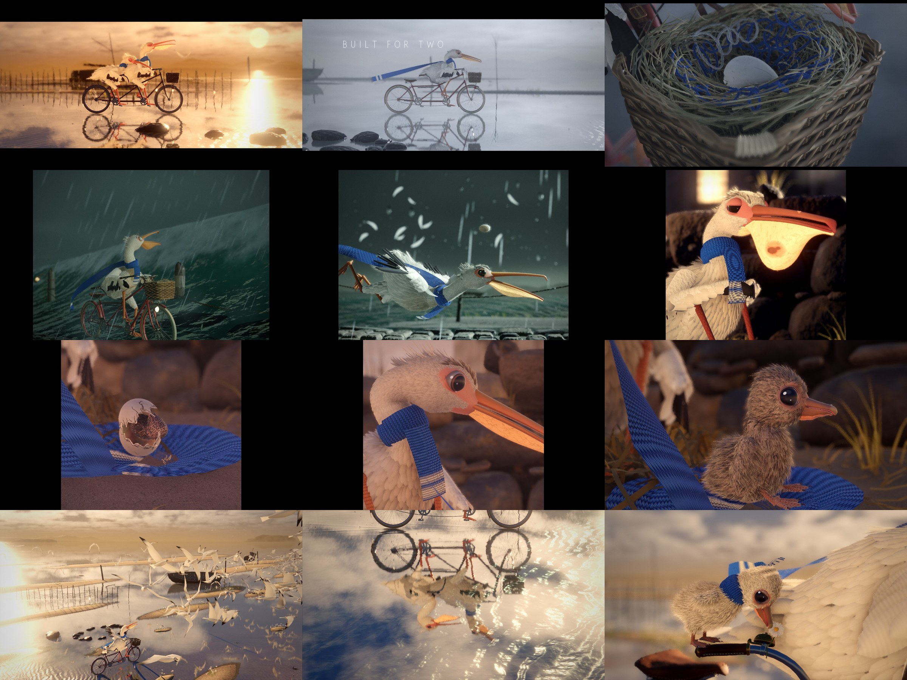

# Built for Two

A four-minute film that draws, plays and **sings itself** live, from one HTML file of plain code.

Download [`index.html`](index.html), open it in desktop Chrome with the sound on, wait for the bar, tap to ride.



## The story

Two old pelicans ride a red tandem across a mirror of wet sand. He sings the questions and she sings the answer, "we two". One cut later the frame and the speed are the same, but her seat is empty and the rear pedals still turn by themselves. He rides on with her egg in the basket and leaves her answers as silence.

A storm throws the egg into the air and he catches it in his bill. With his bill shut he can only hum, so in the dark he hums both parts. At dawn the egg opens, and the answer comes back.

Four things are built for two: the tandem, the scarf, the song and the bell. Each loses its half and gets it back with a new meaning. The full treatment is in [`docs/TREATMENT.md`](docs/TREATMENT.md).

## Plain code

- **No libraries.** Raw WebGL2 and raw typed-array DSP. No three.js, no audio library, no physics engine.
- **No assets.** No image, model, texture, font, sample or recording. Every mesh, feather, shader, wave, note and word is generated when the page loads. The lettering is drawn stroke by stroke.
- **No text-to-speech and no AI voice, music or image service.** The pelican is a physical model of a vocal tract: a glottis blowing into a travelling-wave tube, moved by a jaw, a tongue, lips and a velum.
- **No network.** The page makes no request. It plays from disk with the connection off.

The melody, words, arrangement, story and shots were written for this film. The code was written with Claude; no model makes any sound or picture.

## What you can do

| Input | Action |
|---|---|
| tap, click or B | rings the bell on the empty handlebar. In the grey act he looks back for it and the picture warms; in the last act the chick answers |
| drag | look around; the camera drifts back |
| move over water | a finger on the mirror |
| hold still | blow: wind in the scarf and feathers |
| wheel | closer, further |
| space, arrows, 1 to 6, R | pause, seek 5 s, jump to an act, restart |
| F, M, H, O | full screen, mute, hide hints, skip to the ride |
| after the film | the ride is yours: up and down to pedal, left and right to steer, tap to ring |

## How it is made

| Part | Where |
|---|---|
| the one clock: tempo, melody, words, chords, crank, cues. One turn of the crank is one bar of the waltz | `src/01_score.js` |
| WebGL2 layer, shaders, ray-marched clouds, tidal water with a live ripple field, lens and lab | `src/09_glsl.js` to `src/24_render.js` |
| the colour script | `src/26_moods.js` |
| the tandem, with both chains running at true pitch | `src/40_tandem.js` |
| the pelican: lofted body, about 9,000 instanced feathers, lids, brows, a pouch that shows the egg when lit from behind, wings, leg IK | `src/42_pelican.js` |
| cloth scarf | `src/44_scarf.js` |
| egg, hatching, chick | `src/45_chick.js` |
| causeway, posts, boats, lighthouse, daisies, birds | `src/50_set.js` |
| spray, rain, splashes | `src/60_fx.js` |
| hand-drawn lettering | `src/70_type.js` |
| acting, edit, film | `src/80_stage.js`, `src/82_shots.js`, `src/84_film.js` |
| the voice, the band, the foley, the mix | `src/audio/` |
| loading, clock, hands | `src/86_audio.js`, `src/90_player.js` |

## Build it

```bash
python3 tools/build.py
```

That writes `index.html` from `src/`, byte for byte. Python standard library only. `node tools/mixdown.js out.wav` renders the soundtrack to a file.

## Runs on

Desktop Chrome and Safari with WebGL 2. On an M5 Pro it plays at 60 fps at 2550 x 1452 in Chrome, with the sound ready in about 6 seconds (12 to 17 in Safari's engine). Phones are untested.

## Why the last card

In 1961 a computer at Bell Labs sang "Daisy Bell", the song about a bicycle built for two. The tube model of the vocal tract published by John Kelly and Carol Lochbaum is the ancestor of the one this pelican sings with.
